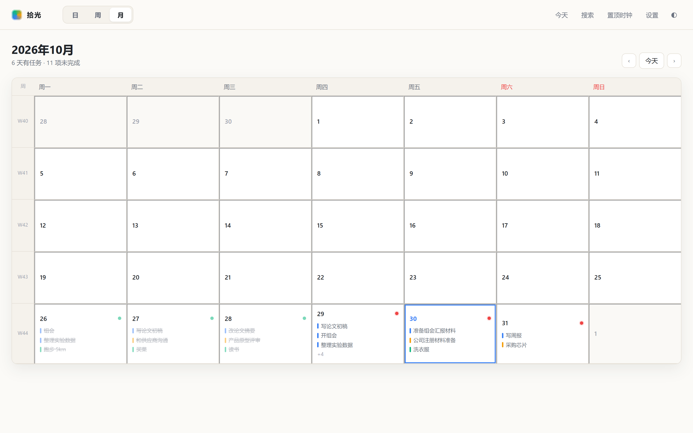
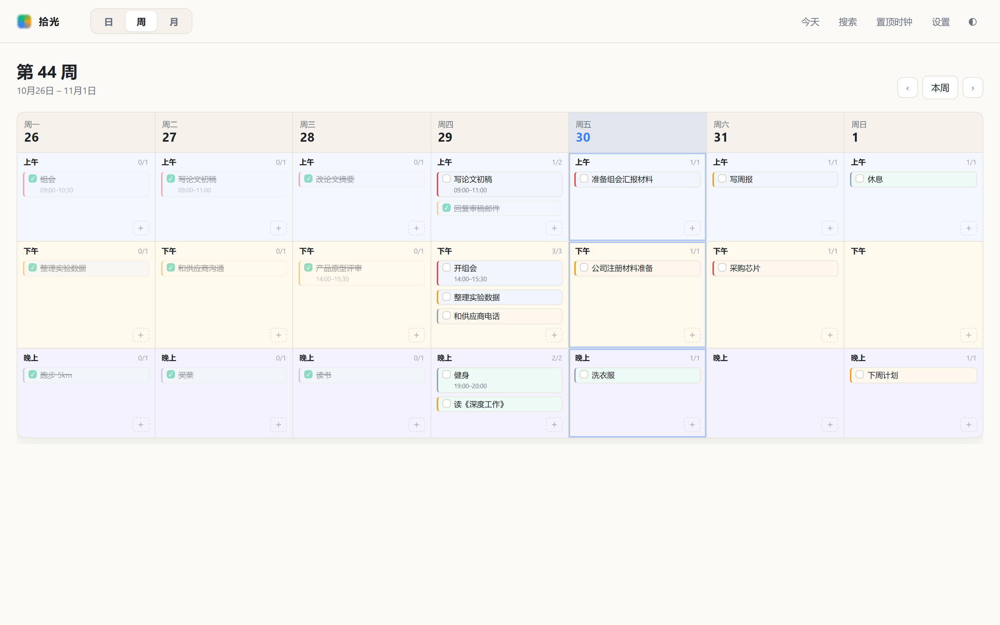
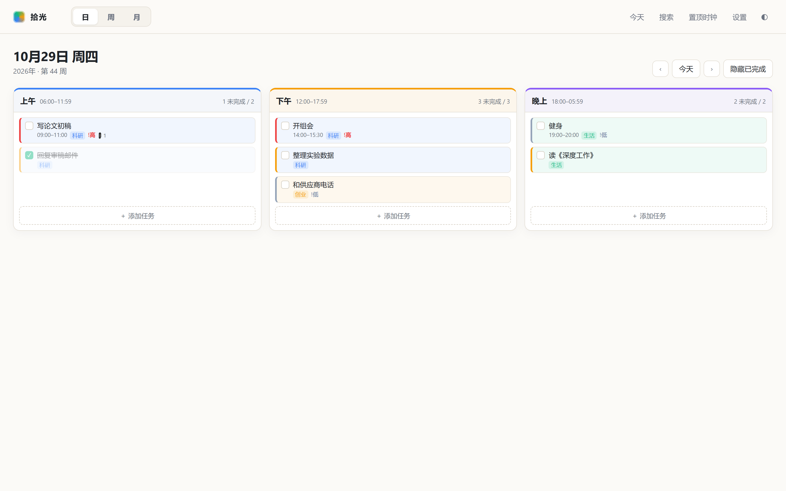
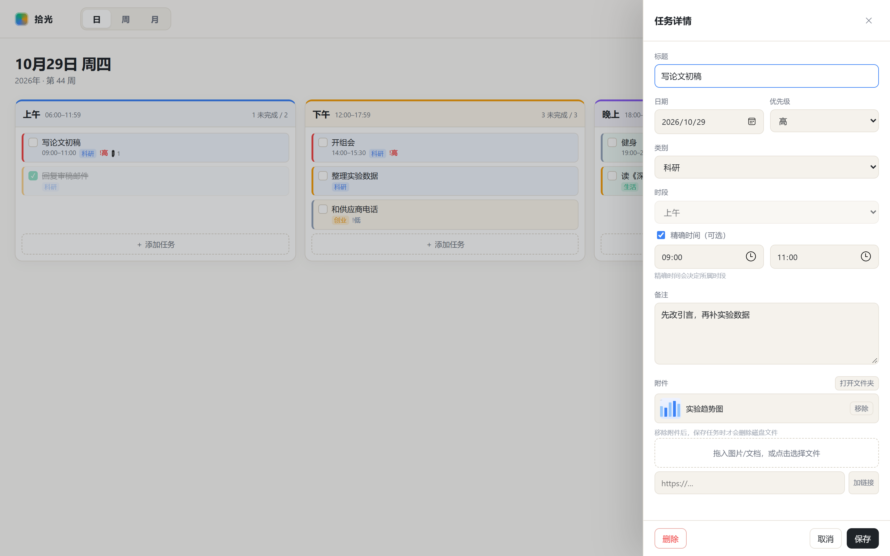
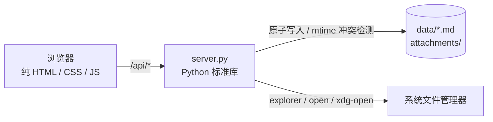

<div align="center">

# 拾光 TODO

**把每一天过成一张干净的纸。**

本地优先 · Markdown 即数据库 · 月 / 周 / 日三视图 · 可置顶桌面时钟


[功能总览](#功能总览) · [快速开始](#快速开始) · [文档索引](#文档索引) · [数据格式](#数据格式) · [技术架构](#技术架构) · [后续规划](#后续规划) · [常见问题](#常见问题)

</div>

---

拾光 TODO 是一个跑在浏览器里的个人时间管理工具。它不依赖云服务，也不使用数据库：所有任务都以 Markdown 文件保存在你自己的磁盘上，方便阅读、搜索、版本管理和长期归档。

核心是纯 HTML / CSS / JavaScript，无框架、无构建；附带的 `server.py` 只负责三件事：提供静态页面、替浏览器读写数据目录、调用系统文件管理器。没有账号，没有同步，没有遥测。

<p align="center">
  
  
</p>
<p align="center">
  
  
</p>

## 功能总览

| 模块 | 能力 |
|---|---|
| **三种视图** | 月视图看全局、周视图排一周、日视图专注当天；月视图周号可跳周，周视图表头可跳日 |
| **速记与整理** | 时段空白处原地速记；任务卡片拖动跨天、跨时段、段内排序；松开即写盘，5 秒可撤销 |
| **任务详情** | 标题、日期、优先级、类别、时段、可选精确时间、备注、附件；关闭前提示保存 |
| **任务级附件** | 每个任务独立文件夹，按需创建；拖入即显示，保存才上传；上传失败自动回滚；支持打开文件夹、真实删除 |
| **桌面时钟** | 秒级走时、可置顶小窗、紧凑模式、今日进度与下一项提醒 |
| **提醒** | 精确时间提前提醒、时段开始提醒；系统通知 + 页面提示 |
| **全局搜索** | 跨全部日期搜索标题、备注、附件；按类别、优先级、状态过滤 |
| **本地优先** | 一天一个 Markdown 文件；数据目录可放任意位置；建议用 Git 做版本管理 |
| **零构建** | 纯静态前端 + Python 标准库服务；改完刷新即可，不依赖 npm |

### 适合谁

- 想把任务数据真正握在自己手里、不接受云同步的人；
- 习惯用 Markdown / Git 管理资料的人；
- 需要「月历 + 课程表 + 当天清单」三种视角切换的人；
- 希望桌面上有一个安静、置顶的小时钟的人。

## 快速开始

### 环境要求

- **Python 3.8+**（仅标准库；Windows 的目录选择框需要 `tkinter`）
- **Chrome / Edge 116+**（推荐；置顶时钟依赖 Document Picture-in-Picture）
- 桌面端鼠标操作；移动端暂未适配

### 启动

```bash
cd todo-app
python server.py
```

浏览器打开 <http://localhost:8000>。

> **不要直接双击 `index.html`。** 页面必须由 `server.py` 提供，否则浏览器无法访问本地数据目录，也无法唤起文件管理器。
>
> 也不要用 `python -m http.server` 代替：它没有 `/api/*` 接口，页面会提示无法连接本地服务。

### 首次使用

1. 点击页面中的「选择数据文件夹」；
2. 在弹出的系统对话框里选择数据目录，例如本仓库的 `todo-app/data`；
3. 完成。工具会自动创建 `YYYY-MM/YYYY-MM-DD.md` 和 `YYYY-MM/attachments/`。

数据目录的绝对路径保存在 `todo-app/config.json`（已加入 `.gitignore`），之后刷新页面无需重复选择。也可以跳过对话框：

```bash
python server.py --data "D:\path\to\your\data"
```

其它参数：

| 参数 | 默认值 | 说明 |
|---|---|---|
| `--host` | `127.0.0.1` | 监听地址 |
| `--port` | `8000` | 端口 |
| `--data` | 无 | 直接指定数据目录 |

## 文档索引

README 只保留总览。每个模块的完整使用手册在 `docs/` 下：

| 模块 | 内容 | 手册 |
|---|---|---|
| 视图与导航 | 月 / 周 / 日视图、周号、表头跳转、逾期面板、hash 路由 | [docs/views.md](docs/views.md) |
| 任务管理 | 速记、详情编辑、完成、删除、撤销、逾期、搜索、外部修改冲突 | [docs/tasks.md](docs/tasks.md) |
| 拖动与排序 | 跨天 / 跨时段 / 段内排序、跨月搬移、精确时间处理、撤销 | [docs/drag-drop.md](docs/drag-drop.md) |
| 附件管理 | 待保存、上传与回滚、打开文件夹、改名、真实删除、命名规则 | [docs/attachments.md](docs/attachments.md) |
| 置顶时钟与提醒 | Picture-in-Picture、紧凑模式、今日进度、系统通知 | [docs/clock.md](docs/clock.md) |
| 数据与备份 | 目录结构、Markdown 语法、Git、冲突检测、迁移 | [docs/data.md](docs/data.md) |
| 本地服务 | 启动参数、HTTP 接口、安全边界、故障排查 | [docs/server.md](docs/server.md) |
| 快捷键 | 全局 / 速记 / 详情 / 搜索 / 拖动 / 鼠标操作 | [docs/shortcuts.md](docs/shortcuts.md) |
| 常见问题 | 为什么需要服务、隐私、多设备、移动端、旧附件 | [docs/faq.md](docs/faq.md) |
| 发展规划 | 产品命名、任务工作区、云同步、AI 史书、桌面端、小程序 | [docs/roadmap.md](docs/roadmap.md) |

## 数据格式

一天一个文件，Markdown 既是存储格式，也是人类可读的界面：

```markdown
# 2026-10-29 周四

## 任务

- [ ] 写论文初稿 @09:00-11:00 !高 #科研 ^t-a1b2
  > 先改引言，再补实验
  - 
  - [需求文档](attachments/t-a1b2-写论文初稿/需求文档.pdf)
  - [参考链接](https://example.com)
- [ ] 整理实验数据 @上午 !中 #科研 ^t-c3d4
- [x] 健身 @19:00-20:00 !低 #生活 ^t-e5f6

## 备注
（手写内容，工具原样保留）
```

| 语法 | 含义 |
|---|---|
| `@上午` `@下午` `@晚上` | 任务所属时段，唯一参与布局的定位信息 |
| `@09:00` / `@09:00-11:00` | 可选精确时间，仅作为卡片标签 |
| `!高` `!中` `!低` | 优先级，不写默认中 |
| `#科研` | 类别，不写默认其他 |
| `^t-a1b2` | 工具维护的稳定 ID，手写时可省略 |
| 缩进 `>` | 任务备注 |
| 缩进 `- [文字](地址)` | 附件或链接 |

保存时会按「上午 → 下午 → 晚上」重新分组，组内保持你拖出来的顺序。完整语法和手写规则见 [数据与备份](docs/data.md)。

## 技术架构



- **浏览器**：只负责渲染、交互和拖动，不持有目录权限。
- **server.py**：保存数据目录的绝对路径，代理全部文件读写，负责唤起文件管理器。
- **数据**：一天一个 Markdown 文件，附件按任务分文件夹；没有数据库、没有索引文件。

设计取舍与安全边界见 [本地服务](docs/server.md)。

## 项目结构

```text
todo-app/
├── index.html            # 应用外壳
├── server.py             # 本地服务：静态文件 + 数据读写 + 文件管理器
├── config.json           # 运行时生成，记录数据目录（已 gitignore）
├── css/
│   └── style.css         # 设计系统与全部样式
├── js/
│   ├── app.js            # 入口、路由、数据变更
│   ├── store.js          # 通过 /api/* 读写数据目录
│   ├── markdown.js       # Markdown 解析与序列化
│   ├── date.js           # 日期、ISO 周、时段工具
│   ├── settings.js       # 本地设置
│   ├── clock.js          # 置顶时钟
│   ├── notify.js         # 提醒
│   ├── search.js         # 全局搜索
│   ├── ui.js             # DOM 与弹层
│   └── views/            # 日 / 周 / 月视图与共享卡片
├── docs/                 # 使用手册与截图
└── data/                 # 默认数据目录（可换成任意位置）
```

没有构建步骤。修改 `js/`、`css/` 或 `index.html` 后直接刷新页面即可。

## 常见问题

**Q：为什么必须运行 `python server.py`？**
浏览器拿不到文件夹绝对路径，也不能直接打开资源管理器。没有本地服务，读写和「打开文件夹」都无法工作。

**Q：数据会被上传吗？**
不会。服务只监听本机，页面不包含任何第三方脚本、统计或网络请求。

**Q：可以把数据目录放在别处吗？**
可以。首次选择时挑任意文件夹，之后也能在设置里更换；旧数据不会被移动或删除。

**Q：删除附件能撤销吗？**
不能。移除并保存即真实删除磁盘文件，恢复依赖 Git。

更多问题见 [docs/faq.md](docs/faq.md)。

## 已知边界

- 置顶时钟没有系统级「最小化到任务栏」，以「收起为纯时钟」作为等效替代。
- 浏览器通知只在页面或置顶小窗开着时生效，关闭页面后不会提醒。
- 不做自动备份，数据目录建议纳入 Git，自行提交。
- 附件会复制进任务文件夹，而不是只记录原路径。
- 精确时间不参与布局；跨时段拖动会清空。
- 仅针对桌面端 Chrome / Edge 优化，移动端和触摸拖动未适配。
- `config.json` 保存的是本机绝对路径，移动项目目录后需要重新选择一次数据文件夹。

## 后续规划

长期方向是把「本地日程工具」演进为「个人时间与资料系统」，产品名提案为 **【Name_ZH】 / 【Name_EN】**：

> **把每一天写成自己的史书。**
> Plan your days. Keep your history.

- **任务即工作区**：新建任务自动拥有文件空间，资料与任务自动绑定，不再手动建文件夹。
- **自有云空间**：多设备自动同步，GitHub 退回为导出 / 备份目标。
- **桌面端**：磨砂玻璃悬浮窗、托盘常驻、番茄钟、每个任务的时间统计。
- **AI 规划与总结**：日 / 周 / 月 / 年计划与回顾，最终装订成个人年鉴。
- **小程序**：手机上快速记录、查看今天和 AI 总结。

完整阶段、架构演进、风险与指标见 [docs/roadmap.md](docs/roadmap.md)。

## 参与开发

- 无框架、无构建、无 npm；改完刷新即可。
- 详细接口与文件说明见 [本地服务](docs/server.md) 和 [数据与备份](docs/data.md)。
- 提交前请确认没有把 `config.json` 或真实数据误提交。
- 目前没有自动化测试套件，改动后建议手动验证：新建 / 编辑 / 拖动 / 附件上传 / 置顶时钟。

## 许可证

本项目尚未指定开源许可证。如需在本仓库之外使用或分发，请先与作者确认。
